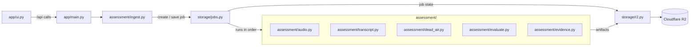
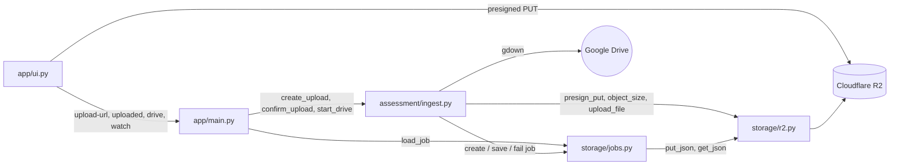
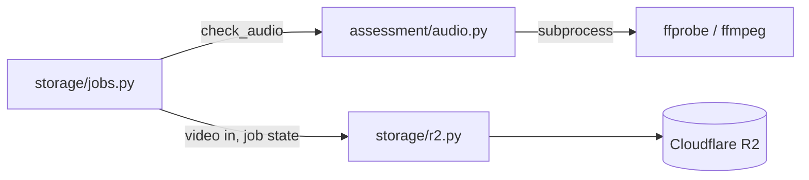
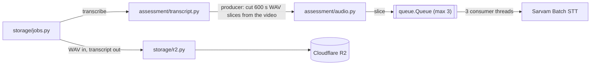
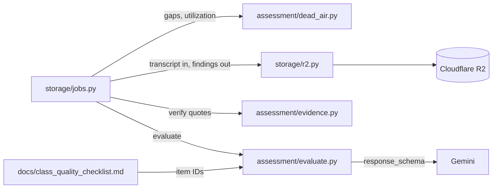

# Class Recording Quality Assessor: Design

Prototype (~5–6 h). Takes an online class recording (upload ≤ 500 MB or a Google Drive link), classifies it as **Poor / Average / Good / Excellent**, and explains why with timestamped, quote-backed observations.

## Lookup table

| Concept / component | File / dir | Purpose |
|---|---|---|
| App entry | `app/main.py` | FastAPI app; mounts the Gradio UI; `/api/*` ingest + job status endpoints |
| UI | `app/ui.py` | Gradio page: upload / Drive link, pushed job status (streamed, no polling), full report at COMPLETE (`render_report`) |
| Deploy | `Dockerfile`, `README.md` | Docker Hugging Face Space: ffmpeg + app on port 7860; Space config front matter |
| Ingest | `assessment/ingest.py` | Upload validation, presigned-upload flow, Drive link parsing, Drive → R2 via `gdown` |
| R2 client | `storage/r2.py` | boto3 S3 client for R2 (presign PUT, HEAD, JSON get/put, file upload); typed via a local Protocol |
| Audio | `assessment/audio.py` | ffprobe duration/audio check; ffmpeg cuts 16 kHz WAV slices and clips straight from the video; grab 3 frames |
| ASR | `assessment/transcript.py` | Producer-consumer: ffmpeg cuts 10-min overlapping slices into a queue, 3 threads run one Sarvam Batch job per slice; merge (dedup at overlap midpoint) and normalise to timestamped segments |
| Dead air | `assessment/dead_air.py` | Pure Python: dead-air gaps ≥ 3 min and time utilization % from segment timestamps |
| LLM | `assessment/evaluate.py` | Gemini calls: transcript evaluation, flagged-clip recheck, camera frames |
| Prompts | `assessment/prompts.md` | Gemini system prompt and task instructions (loaded by `evaluate.py`) |
| Evidence check | `assessment/evidence.py` | Verify each cited quote exists in the transcript near its timestamp |
| Checklist parser | `assessment/checklist.py` | Parses item IDs, tier, main/extra and source tags (`[Video]` = video-only) from `docs/class_quality_checklist.md` |
| Jobs | `storage/jobs.py` | Background pipeline runner; job state + result JSON stored in R2; in-process status notifier (`watch`); `load_report` reads the findings for the page |
| Errors | `app/errors.py` | `AppError` with stable codes; error envelope |
| Config | `app/config.py` | Env vars (keys, bucket, model IDs, thresholds) |
| Checklist | `docs/class_quality_checklist.md` | Quality criteria, item IDs (`exe`, `gd`, `avg`, `pr`) |
| Scoring rules | `docs/scoring_logic.md` | The tier ladder: red flags, caps, then Excellent/Good thresholds |
| Scoring | `assessment/scoring.py` | Found item IDs + duration → tier, provisional flag, reason |
| Labelled eval | `scripts/eval_labelled.py` | Run the pipeline on labelled recordings; print predicted vs expected |
| Tests | `tests/` | pytest unit tests (dead air, evidence, ASR merge, checklist, scoring, UI status) |

## Pipeline

How the modules fit together. `jobs.py` runs the pipeline steps in order, and every module reaches R2 only through `r2.py`.



Steps 7–8 only re-mark the affected items and re-run scoring. They never re-run the full evaluation (partial rescore, see `docs/scoring_logic.md`).

## Key decisions

| Decision | Why |
|---|---|
| Browser uploads straight to R2 (presigned PUT) | Avoids pushing 500 MB through the Space's proxy. Needs a CORS rule on the bucket and a small custom JS snippet in Gradio. |
| R2 stores results and job state too | Hugging Face Space disk is wiped on restart or sleep |
| Sarvam Batch STT via the `sarvamai` SDK, one job per 10-min slice, fed by a queue | Handles Malayalam and English. Transcription starts as soon as the first slice is cut instead of waiting for the whole file, and 3 slices transcribe at once. Slices overlap by 15 s so a sentence on a cut is heard whole by one slice. **Exception:** `sarvamai` has ~41k weekly downloads (< 100k); approved by the user as the vendor's official SDK. |
| One Gemini call over the full transcript | ~10–15k tokens per hour fits easily. Chunking would break whole-class items (`exe01`, `exe04`, `gd01`, `gd04`, `pr06`). |
| Gemini for text, audio and image | One provider; accepts audio clips (edge case 1) and frames (edge case 2) |
| Prompt caching | Implicit Gemini caching; prefix order system → checklist → transcript so the job's recheck calls hit the cache (static part alone is under the 4,096-token minimum) |
| Dead air computed in code, not by the LLM | Deterministic and exact; the LLM gets it as a fact |
| Every finding cites timestamp + quote, verified in code | Specific observations; catches made-up quotes |
| Scoring in Python, not the LLM | Reproducible; cheap to re-run after a recheck |
| No speaker diarization | The LLM infers speakers from context. Known limitation for talk-time items (`exe07`, `avg05`). |
| One process: FastAPI + Gradio (`gr.mount_gradio_app`) on a Docker Space | Single deploy; ffmpeg installed in the image |
| `gdown` for Drive links | Handles Drive's large-file confirmation page. **Exception:** single maintainer touching network/file I/O; approved by the user. |

## Build pieces

The pipeline is built and verified one piece at a time.

### Piece 1: Ingest (video → R2)

**Goal:** a recording ends up in R2 at `videos/{job_id}.{ext}` with a job record at `jobs/{job_id}.json`. No processing yet.

**Modules.** The video goes straight from the browser to R2. The server only signs the URL, confirms the upload, or pulls a Drive file.



**Path A: file upload (≤ 500 MB)**
1. The UI sends `POST /api/upload-url` with `{filename, size}`. The server picks the content type from the extension and returns it with the URL; the browser must send it as the PUT `Content-Type`.
2. The server checks that `size ≤ 500 MB` and the extension is `mp4 / mkv / webm / mov`. It creates `job_id`, writes the job record (`status: "UPLOADING"`), and returns a presigned **single PUT** URL (no multipart; expires in 1 h). `ContentLength` is signed so R2 rejects a different size.
3. The browser PUTs the file straight to R2 (custom JS in Gradio, with progress shown).
4. The UI sends `POST /api/jobs/{job_id}/uploaded`. The server HEADs the object to confirm it exists and the size matches, then sets `status: "EXTRACTING"` and queues the pipeline. A duplicate confirm is a no-op and queues nothing.

**Path B: public Google Drive link**
1. The UI sends `POST /api/drive` with `{url}`.
2. The server checks it's a `drive.google.com` file link, creates `job_id`, and sets `status: "UPLOADING"`.
3. A background task runs `gdown` to a temp dir, rejects files over 500 MB or with an unsupported extension, uploads to R2 in one call, deletes the temp file, and sets `status: "EXTRACTING"`.

**Job record** (`jobs/{job_id}.json`):
```json
{ "job_id": "…", "source": "upload|drive", "video_key": "videos/….mp4", "size_bytes": 0,
  "status": "UPLOADING|EXTRACTING|TRANSCRIBING|EVALUATING|SCORE_APPLYING|COMPLETE|FAILED", "error": null, "created_at": "…" }
```

**Errors:** `UPLOAD_TOO_LARGE`, `UNSUPPORTED_FILE_TYPE`, `INVALID_DRIVE_LINK`, `DOWNLOAD_FAILED` (private file, Drive quota), `STORAGE_FAILED`, `JOB_NOT_FOUND`, `UPLOAD_INCOMPLETE` (confirm called before the object is in R2; job stays `UPLOADING`).

**Status tags (pushed, not polled):** `UPLOADING → EXTRACTING → TRANSCRIBING → EVALUATING → SCORE_APPLYING → COMPLETE`, or `FAILED` at any point. Polling R2 every 3 s per open page hit Cloudflare's request limits, so the backend now pushes each tag:
- `jobs.save_job` writes the record to R2, then stores a copy in an in-process map and wakes every watcher (`threading.Condition`).
- `jobs.watch(job_id)` yields the job now and on each status change until `COMPLETE`/`FAILED`, repeating it every 30 s with no change so a closed page's stream ends. It reads R2 only if this process never saved the job (e.g. after a restart); no pipeline runs for it here, so it yields that record once and stops.
- The Gradio page runs `watch_status` (a generator) when the Job ID is set and streams each render over Gradio's own SSE connection, with `concurrency_limit=None` so watchers don't queue behind each other.
- Limitation: one process only (fine for a single-container Space). `GET /api/jobs/{job_id}` still returns the stored record for scripts.

**UI (minimal):** file picker, Drive link box, submit, and the job ID with a pushed status.

**Done when:**
- Unit tests: size and extension validation, Drive URL parsing, job record round-trip.
- Manual check: upload a real recording, and the object and the `uploaded` job record show up in R2. A public Drive link does the same.
- Unhappy paths: a 501 MB file is rejected before upload; a private Drive link ends `FAILED` with `DOWNLOAD_FAILED`; reloading the page mid-upload leaves the job `UPLOADING`, not a half object marked `EXTRACTING`.

**Needs:** R2 bucket CORS rule allowing `PUT` from the Space origin (and `localhost`).

### Piece 2: Prepare the video (video → duration)

**Goal:** the job's video is downloaded once to a temp dir, checked for an audio track, and its duration recorded on the job. No full-length WAV is made: Piece 3 cuts 16 kHz WAV slices straight from this video.

**Modules.** `audio.py` owns every ffmpeg/ffprobe call, and `jobs.py` moves the files in and out of R2. Pieces 2 and 3 run in one function (`jobs._transcribe`) so they share the temp dir and the video is downloaded only once.



**Trigger:** starts automatically when the job reaches `status: "EXTRACTING"`. It runs in the background task: `storage/jobs.run_pipeline` is queued after a successful `POST /api/jobs/{job_id}/uploaded` (not after a duplicate confirm), and after the Drive download for Path B. It does nothing unless the job is `EXTRACTING`, so a failed download doesn't start a run.

**Steps:**
1. The job is already `EXTRACTING`. Download `videos/{job_id}.{ext}` from R2 to a temp dir.
2. `ffprobe` reads the duration and checks there's an audio stream (`audio.check_audio`).
3. Add `duration_s` to the job, set `status: "TRANSCRIBING"`, and go straight into Piece 3 with the same temp dir.

**Why no full WAV:** converting the whole file first, uploading the WAV to R2 and downloading it again cost two extra transfers (~85 MB each for a 44-min class) and delayed the first Sarvam call until the whole file was converted. Cutting each slice from the video decodes the same audio (+~2.5 % for the overlaps) and reads only that slice's part of the file. Edge case 1 (clip recheck) cuts its clip from the video the same way.

**Errors:** `NO_AUDIO_STREAM`, `MEDIA_FAILED` (ffprobe/ffmpeg error or timeout), `STORAGE_FAILED`.

**Done when:**
- Unit tests: `check_audio` returns ~5 s for a 5 s test video (`lavfi` sine + testsrc); a video with no audio track raises `NO_AUDIO_STREAM`; a corrupt file raises `MEDIA_FAILED`. `cut` turns a segment of an H.264/AAC video into 16 kHz mono 16-bit WAV of the right length, and the seek is exact (a tone starting at 10 s is silent before and loud after the 10 s mark of an 8–12 s cut).
- Unhappy path: a corrupt file (renamed `.txt` → `.mp4`) ends `FAILED` with `MEDIA_FAILED`, not a hang.

### Piece 3: Speech-to-text (audio → transcript)

**Goal:** 10-minute 16 kHz WAV slices are cut straight from the video and flow through a queue to Sarvam Batch STT, and a normalised, timestamped transcript lands in R2 at `transcripts/{job_id}.json`.

**Modules.** `transcript.py` runs the producer-consumer pipeline, talks to Sarvam and normalises the output. Cutting reuses `audio.py`.



**Trigger:** runs right after Piece 2, in the same function and temp dir.

**Steps:**
1. The job is `TRANSCRIBING` and the video is in the temp dir (Piece 2).
2. **Producer (ffmpeg, the calling thread):** `plan_slices` gives 600 s slices (9 min 45 s of their own + 15 s shared with the next) starting every 585 s: 0–600, 585–1185, 1170–1770, … It stops once a slice reaches the end, so no slice is all overlap. Each slice is cut from the video and converted in one ffmpeg call (`-ss`/`-t` before `-i`, `-vn -ac 1 -ar 16000 -c:a pcm_s16le`), put on a `queue.Queue` bounded at 3 (ffmpeg stays at most one slice per consumer ahead), and logged.
3. **Consumers (3 threads, `CONSUMERS`):** each takes the next slice off the queue and runs one Sarvam Batch job for it via the `sarvamai` SDK (API key from the env var `api_subscription_key`, read in `app/config.py`): create job → upload the slice → start → poll until done (timeout 30 min) → download the output. Model `saaras:v4`, mode `transcribe` (original language kept, no translation; quotes stay faithful), language auto-detect (covers Malayalam, English and code-mixed speech). Diarization on, with speaker count left to auto.
   **Logs per slice:** `Job …: slice 2/7 cutting (585–1185 s)` → `queued` → `sent to Sarvam` → `transcribed` (or `failed: …`, then later slices `skipped`).
   **Failure:** the first failed slice sets a stop flag; the producer stops cutting, consumers skip what's left, every thread is joined, and the first error is raised (`ASR_FAILED`, or an unexpected error → `INTERNAL_ERROR`). Nothing hangs: consumers keep draining the queue until they get their stop sentinel.
4. Save the raw Sarvam output to `transcripts/{job_id}.raw.json` (for debugging, never shown).
5. Normalise each slice in slice order, add its `offset_s` to every timestamp, and drop overlap duplicates: the cut between slice N and N+1 is the **midpoint of their shared 15 s** (e.g. 592.5 s), slice N keeps segments starting before it and slice N+1 keeps those from it on. Concatenate and save to `transcripts/{job_id}.json`:
   ```json
   { "language": "ml-IN", "segments": [ { "start_s": 12.4, "end_s": 18.9, "speaker": "SPEAKER_00", "text": "…" } ] }
   ```
6. Set `transcript_key` (saved with the next status).

**Errors:** `ASR_FAILED` (job failed, timed out or returned an empty transcript), `STORAGE_FAILED`.

**Done when:**
- Unit tests: the normaliser turns a Sarvam response into the segment shape. A 1300 s audio plans and cuts into 600 + 600 + 130 s slices at 0 / 585 / 1170 s; merging keeps a line at 590 s from slice 1 and one at 595 s from slice 2; `transcribe` with Sarvam faked sends all 3 slices and dedups the overlaps; a failing slice raises `ASR_FAILED` without hanging.
- Known limitations: speaker labels are per Sarvam job, so `SPEAKER_00` in one slice may be a different person in the next (the LLM already infers speakers from context). A segment longer than the overlap that starts just before the midpoint may be cut short at the end of its slice.
- Manual check: one Malayalam and one English labelled recording reach `EVALUATING`. Spot-check 3 timestamps against the audio; they're within a few seconds.
- Unhappy path: an invalid API key ends `FAILED` with `ASR_FAILED`, and the message says why.

**SDK calls (sarvamai 0.1.36):** `SarvamAI(api_subscription_key=…).speech_to_text_job.create_job(model="saaras:v4", mode="transcribe", language_code="unknown", with_diarization=True, with_timestamps=True)` → `upload_files` → `start` → `wait_until_complete` → `get_file_results` (per-file failures) → `download_outputs` (one `{input}.json` per file). Timestamps are chunk-level (phrases). The normaliser uses `diarized_transcript.entries` (with `speaker_id`) and falls back to `timestamps` chunks (speaker `null`).

**Open:** Sarvam's limit on concurrent Batch jobs per key (if 3 at once is rejected, lower `CONSUMERS`); the real output file shape still needs confirming on the first live run (the unit tests use a hand-written sample until a real response is saved in `tests/fixtures/`).

### Piece 4: Evaluate (transcript → checklist findings)

**Goal:** Gemini marks every checklist item **found / not found** with evidence, in exactly the shape `docs/scoring_logic.md` consumes. Findings are saved to `findings/{job_id}.json`. The tier itself is Piece 5 (scoring).

**Modules.** Plain Python computes the facts and checks the quotes. `evaluate.py` is the only module that calls Gemini.



**Trigger:** runs right after transcription and sets `status: "EVALUATING"`.

**Inputs built in code (no LLM):**
- Item IDs and text, parsed from `docs/class_quality_checklist.md` (no second copy).
- Transcript lines formatted as `[mm:ss] SPEAKER_00: text`.
- Facts (`assessment/dead_air.py`, plain Python over segment timestamps): `duration_s`, the time of the first speech, dead-air gaps ≥ 3 min (for `avg02`), and **time utilization** for `gd04`:
  `utilization% = (duration_s − sum of gaps ≥ 30 s, including before the first and after the last segment) ÷ duration_s × 100`.
  Gemini is told to use these facts rather than guess. For `gd04` it marks found only if utilization ≥ 95% **and** the transcript shows no rushed or neglected section.

**Prompt layout (for caching):** static prefix first, then the per-job part.
1. System prompt (role, rules, output schema): static
2. `class_quality_checklist.md`: static
3. Transcript + facts: per job
4. Task instruction: per call

**Caching:** Gemini's **implicit** caching (on by default, no code; 90% discount on cached tokens). Its minimum prefix length depends on the model (it was **4,096 tokens** for `gemini-3.8-flash`; check the current figure for `gemini-3.5-flash-lite`), and the system prompt + checklist alone are only ~2.5k, so they won't cache on their own. They do cache as part of a longer prefix: system + checklist + transcript (10k+ tokens) is the shared prefix for this call **and** the later recheck calls on the same job (edge cases 1 and 2), which run minutes later. So we rely on implicit caching and put the transcript **before** the call-specific instruction. No explicit cache objects.

**Model:** `gemini-3.5-flash-lite` (default in `app/config.py`, overridable with `GEMINI_MODEL`; key from `GEMINI_API_KEY`), called through the **Interactions API** (`client.interactions.create`) as in [the thinking docs](https://ai.google.dev/gemini-api/docs/thinking): `generation_config={"thinking_level": "medium"}` ("low" gave zero thought tokens and over-marked items in testing), JSON output via `response_format={"type": "text", "mime_type": "application/json", "schema": …model_json_schema()}`, result read from `interaction.output_text`. A non-`completed` interaction (e.g. `incomplete`) is `LLM_FAILED`.

**Times:** Gemini returns evidence and flag times as the `mm:ss` it sees in the transcript (`{"time": "30:30", "quote": …}`); code converts them to `start_s`, so no arithmetic is left to the LLM. The stored findings use the `start_s` shape below. Video-only items are forced to not found with "Needs video check." in code, whatever Gemini returns.

**Stored** at `findings/{job_id}.json`: `items`, `flagged_segments`, `rejected_evidence`, `facts`, `model`, `usage` (input / cached / thought / output tokens).

**Output schema** (one entry per checklist item, all 23 required):
```json
{ "items": [
    { "id": "avg02", "found": true,
      "evidence": [ { "start_s": 1830, "quote": "ok, do it yourselves, I'll be back" } ],
      "observation": "Teacher left students working silently for ~4 min (30:30–34:40) with no check-in." } ],
  "flagged_segments": [ { "start_s": 2210, "end_s": 2218, "reason": "'kill the process' looks like a mis-hearing in a maths class" } ] }
```
- `found: true` needs at least one evidence entry; `observation` must name what happened and when, not a generic statement.
- Video-only items (`exe02`, `exe05`, `pr01`): Gemini returns `found: false` with the observation "needs video check"; edge case 2 decides them later (per `scoring_logic.md`: not found until checked).
- `flagged_segments` feed edge case 1.

**Validation in code (after the call):**
1. Schema check: every checklist ID exactly once, no unknown IDs. On failure, retry once, then `LLM_BAD_OUTPUT`.
2. Evidence check (`assessment/evidence.py`): each quote must appear in a segment within ±30 s of `start_s`, compared after case-folding, dropping punctuation and filler words (uh, um, ah, …) and collapsing whitespace. A found item with no surviving quotes is set to **not found**, and the dropped quotes are logged in `rejected_evidence` (kept in the JSON, never shown to the user).
3. Fact-gated items (`FACT_GATES` in `evidence.py`): `gd04` stays found only if utilization ≥ 95%, `avg02` only if there's at least one dead-air gap ≥ 3 min. When the gate passes they stay found even with no surviving quote (Gemini may cite the facts, which aren't in the transcript); when it fails they're set to not found. Gemini still decides the judgment part (no rushed section, no check-ins).

**Errors:** `LLM_FAILED` (API error or timeout), `LLM_BAD_OUTPUT`, `STORAGE_FAILED`.

**Done when:**
- Unit tests: checklist parser returns the 23 IDs; dead-air finds a 4-min gap in a synthetic transcript and ignores a 2-min one; utilization on a synthetic 60-min transcript with 3 min of ≥ 30 s gaps is 95%; evidence check keeps an exact quote, drops a made-up one and one 2 min off; schema check rejects a missing ID.
- Manual check: run on labelled recordings; every found item has a real quote you can find at its timestamp; usage metadata shows cached tokens on the recheck calls.

**Known limitation:** utilization is measured against the recording length, not the scheduled length. A class that ends early but is busy while it lasts can still score high (an early exit is covered by `pr03`). Silent but legitimate work time counts as unused.

### Piece 5: Scoring
**Goal:** turn the found items into a tier, with plain Python (`assessment/scoring.py`), following the ladder in `docs/scoring_logic.md`. It runs at the end of the evaluate step, after the evidence check, under `status: "SCORE_APPLYING"`; the result goes into `findings/{job_id}.json` as `score` and onto the job record with `status: "COMPLETE"`, and the page shows it.

**Report on the page:** at `COMPLETE` the status stream reads `findings/{job_id}.json` once (`jobs.load_report`, which validates only the shown parts) and appends the full report under the grade: all 23 items grouped by tier in checklist order (✓/✗, ID, title, observation, and `[mm:ss] “quote”` evidence), then class facts (duration, first speech, utilization %, dead-air gaps) and flagged lines with their reasons. Rejected quotes and token usage are never shown. Every Gemini-written string is HTML-escaped.

- **Ladder (first match wins):** red flag (`pr01`, `pr02`, `pr07`) → Poor; 2+ Poor items → Poor; any Average primary (`avg01–04`) → Average; 1 Poor item → Average; `exe01` and `exe03` → Excellent; 2+ of `gd01–03` → Good; otherwise Average.
- **Short class:** under 5 minutes the score is `provisional` and shown as "On Track for [Tier]".
- **Output:** `Score{tier, provisional, reason}`; the reason names the rule and the item IDs that fired it.
- **Why a ladder, not percentages:** the earlier percentage comparison could never rank a class Excellent over Good when all four Good items were found (7 vs 4 items), and the v2.0 checklist states each tier as a threshold.
- **Rule IDs** (`RED_FLAGS`, `EXCELLENT_REQUIRED`) are constants in `scoring.py`; a test checks they exist in the checklist.

### Piece 7: Deployment
_To be specified._ Hugging face spaces

**Done when:**
- Deployed Space URL works: one labelled recording uploaded through the page reaches a report whose tier matches its label (or the mismatch is explained), and one public Drive link does the same.
- Unhappy paths on the live Space: 501 MB file rejected in the browser; a private Drive link shows `DOWNLOAD_FAILED`; reloading mid-job with `?job=` resumes the status stream; double-clicking **Assess** creates only one job; closing the tab mid-upload leaves the job `UPLOADING`.
- Screenshots looked at: input, in-progress, report, failed; at phone width and in dark mode; with a long report.

**Open:** add a shared password, or leave the Space open? (Open means anyone can spend Sarvam/Gemini credits.)

## Edge cases

1. **Possibly mistranscribed line.** Gemini #1 flags it with a timestamp. The audio clip (±15 s) goes to Gemini #2, which corrects the reading and re-marks the affected items; then scoring runs again.
2. **Camera on (teacher and students).** Three frames: at 10:00, the middle, and end − 2 min. Gemini #3 judges them. If the recording is shorter than 12 min, use 25% / 50% / 90% of the duration. Limitation: in a screen-share recording the camera may be a thumbnail or not visible at all.

## Error envelope

```json
{ "error": { "code": "ASR_FAILED", "message": "Sarvam batch job failed: <reason>", "job_id": "abc123" } }
```

Codes: `UPLOAD_TOO_LARGE`, `UNSUPPORTED_FILE_TYPE`, `INVALID_DRIVE_LINK`, `STORAGE_FAILED`, `DOWNLOAD_FAILED`, `MEDIA_FAILED`, `NO_AUDIO_STREAM`, `ASR_FAILED`, `LLM_FAILED`, `LLM_BAD_OUTPUT`, `JOB_NOT_FOUND`, `JOB_INTERRUPTED`, `UPLOAD_INCOMPLETE`, `INTERNAL_ERROR` (unexpected error; HTTP 500, or recorded on a background job before re-raising). A job that fails stores the envelope as its status.

## Open items

- Sarvam Batch: max file size and timestamp granularity: confirm before building `assessment/transcript.py`
- Location and format of the labelled dataset
